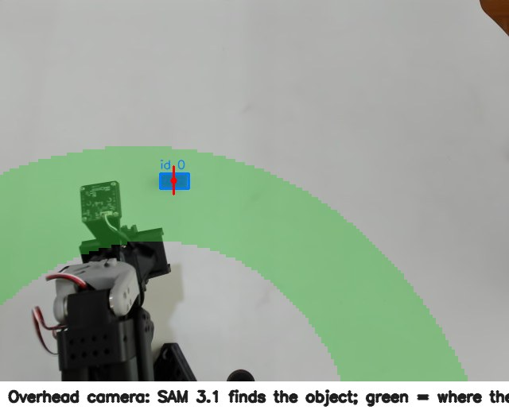
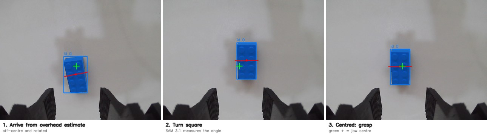

# Say-and-Grasp

**A voice-controlled third hand for your workbench.** Say *"pass me the side cutters"* and a $250 robot arm finds them, picks them up and puts them down by your hand, using Meta's Muse Spark and SAM 3.1 with **zero task-specific training**. Every handover is also recorded as a training episode and labelled by Muse Spark, so the robot builds its own dataset as it works.

Built for the **Meta Global AI Developer Hackathon** (Oct 26 – Nov 4, 2026), Indie Developer track.



## Why

Anyone who builds hardware knows the moment: you're holding the iron and a wire, and the tool you need is just out of reach or buried on the bench. Makers, repair technicians and electronics labs lose small chunks of time to this all day. For people who can't easily reach across a bench, it's a real barrier.

Low-cost robot arms could help, but today they learn one task at a time from dozens of human demonstrations. Say-and-Grasp needs none. It understands the request, finds the tool and grasps it zero-shot. Each successful run then becomes a demonstration, so the arm can later be trained on data it collected itself.

## How it works

You say *"pass me the side cutters"*. **Muse Voice Transcribe** turns it into text, and **Muse Spark** reads the request alongside a fresh photo of the bench. It works out which tool you mean and calls the robot's **`fetch`** tool. **SAM 3.1** finds the tool in the **overhead camera**; its outline gives a grasp point and jaw angle, which the calibration turns into a position on the table. The arm moves above the tool, and **SAM 3.1** looks again through the **wrist camera**. If the jaws are off-centre or not square to the tool, it **corrects and re-checks** until they're lined up. Then it **grasps, checks the grip, and hands the tool over**. Finally, **Muse Spark checks the handover** in the overhead view, and the whole run is saved as a **LeRobot dataset episode** with that verdict as its label.

| Step | Meta model | What it does |
|---|---|---|
| Hear | **Muse Voice Transcribe** | Turns your spoken request into text |
| Understand | **Muse Spark** (vision + tool calling) | Looks at a photo of the bench, maps vague words to what's there ("the thing for cutting wire" → side cutters) and calls the robot's `fetch` tool |
| Find | **SAM 3.1**, overhead camera | Finds the tool from its name; the mask gives a grasp point and jaw angle, mapped to table coordinates |
| Align | **SAM 3.1**, wrist camera | Hovering above the tool, measures how far off-centre and how rotated it is relative to the jaws, corrects and re-checks. It only descends once the wrist camera confirms the jaws are lined up |
| Act | — | Top-down inverse kinematics on the SO-101, grip check, handover |
| Verify | **Muse Spark** | Looks at the handover spot and judges whether it worked; that verdict labels the episode |



### Behaviour that makes it feel alive

- **Never grabs blind.** It descends only when the wrist camera confirms the jaws are centred and square on the object.
- **Follows a moved object.** Nudge the tool while the arm is on its way and the wrist camera sees where it went; the arm follows it and re-aligns.
- **Recovers from a miss in place.** If the grip comes up empty, it rises, looks again and re-grabs without going back home.
- **Speaks naturally.** It says what it's doing as it starts ("On it, grabbing the side cutters") and confirms when it's done.
- **Honest about limits.** If something is out of reach, or it can't line up with it, it says so instead of trying anyway.

## The self-training loop

Every `fetch` is recorded at 15 fps as a [LeRobot](https://github.com/huggingface/lerobot) dataset episode:

| Feature | Content |
|---|---|
| `observation.images.overhead` / `observation.images.wrist` | both camera views |
| `observation.state` / `action` | 5 arm joints + gripper, read and commanded |
| `task` | e.g. *"pick up the side cutters and hand it over"* (language-conditioned, ready for SmolVLA) |
| `labels.jsonl` | Muse Spark's success verdict and reason for each episode |

The zero-shot system does the work; the dataset grows by itself, with **no human demonstrations**. Episodes use LeRobot's standard SO-101 feature names, so `lerobot-train` (ACT, SmolVLA, …) can train on the successful episodes directly.

```bash
sag-dataset            # episodes, success rate, per-object breakdown
sag-dataset --push     # upload to the Hugging Face Hub
```

## Hardware

- SO-101 follower arm with a parallel gripper (LeRobot)
- Overhead USB camera (Logitech 4K Stream) looking straight down at the bench
- Wrist camera on the gripper (Innomaker U20CAM)
- A laptop with no GPU; all models run through Meta Model API

## Setup

```bash
conda activate lerobot                # LeRobot env (arm control)
pip install -e .                      # installs the sag-* commands
export META_API_KEY=your-key          # dev.meta.ai → API keys
sudo apt install -y libportaudio2 espeak-ng   # microphone + spoken replies

# SO-101 model for kinematics (once)
git clone --depth 1 https://github.com/TheRobotStudio/SO-ARM100.git /tmp/soarm
cp -r /tmp/soarm/Simulation/SO101 assets/
```

One-time calibration, in this order (each takes a few minutes):

```bash
sag-calibrate --tcp                                  # where your gripper actually grasps
sag-calibrate --camera 4 --marker "blue block"       # overhead camera ↔ arm (8 touches)
sag-calibrate --refit --marker-height 11             # if you touched the TOP of an 11 mm marker
sag-pick --save-home                                 # folded rest pose, out of the camera's view
sag-pick --save-clear                                # rest pose with the wrist lifted off the base
sag-calibrate --wrist --wrist-camera 2 --marker "blue block"   # wrist-camera alignment
sag-spots set handover 420,280                       # where tools are put down for you (overhead pixel)
sag-pick --show-reach                                # check the reachable zone (outputs/reach.png)
```

## Use

```bash
sag-agent                     # push-to-talk: Enter, speak, Enter
sag-agent --text              # type requests instead
sag-agent --text --push       # …and upload the dataset to the Hub when you quit
```

Lower-level tools: `sag-segment` (run SAM 3.1 on a camera or image), `sag-pick` (pick one named object without the assistant).

## Repo layout

```
src/say_and_grasp/
  agent.py         Muse Spark assistant: tools, one-call fetch, handover verification
  skills.py        look / pick / place: overhead + wrist-camera alignment, follow, retry
  sam.py           SAM 3.1 via Meta Model API: prompt → masks → grasp targets
  voice.py         push-to-talk + Muse Voice Transcribe, spoken replies
  recorder.py      every fetch → LeRobot dataset episode
  kinematics.py    top-down IK on the SO-101 URDF (placo), grasp-centre offset
  arm.py           smooth, gravity-compensated arm and gripper control (LeRobot)
  calibration.py   overhead pixel ↔ table mapping, table plane, reach limits
  camera.py        single shots and background camera streams
  spots.py         named bench spots (handover)
  cli/             sag-agent, sag-pick, sag-calibrate, sag-segment, sag-dataset
config/            per-setup calibration (camera, gripper, wrist camera, home pose)
assets/SO101/      SO-101 URDF + meshes (fetched, not committed)
data/              recorded episodes (pushed to the Hub, not committed)
docs/images/       README images
```

## What existed before the hackathon

To keep the judging clear: the SO-101 arm hardware and its LeRobot setup (motor calibration, teleoperation) existed before the event. Everything in this repository was written during the hackathon.

## License

[MIT](LICENSE)
